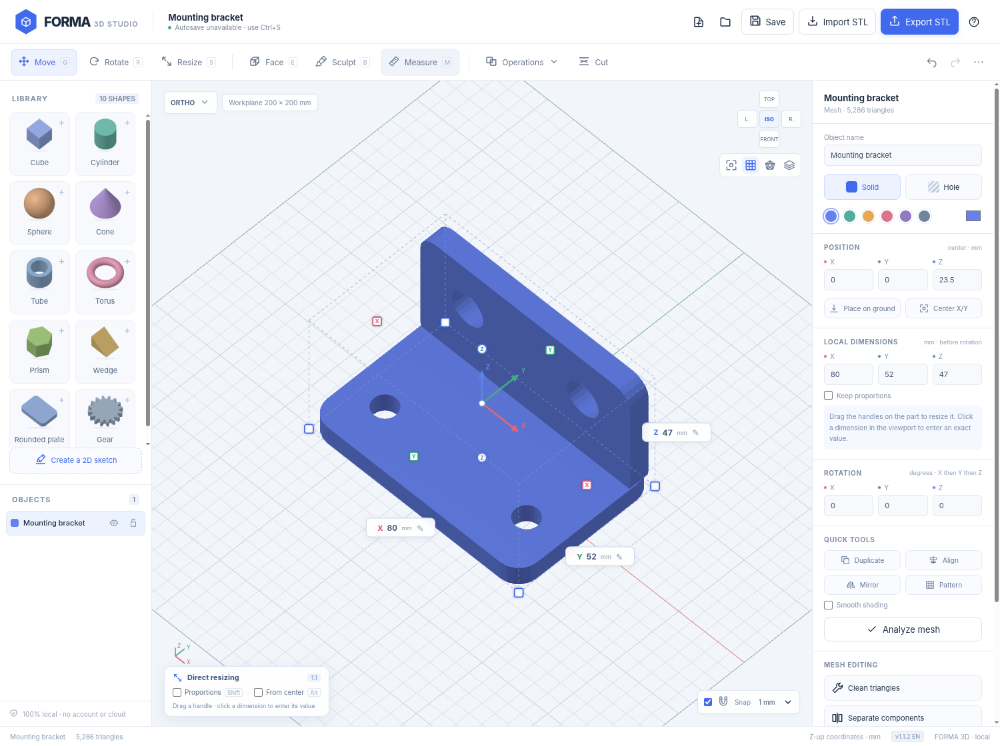
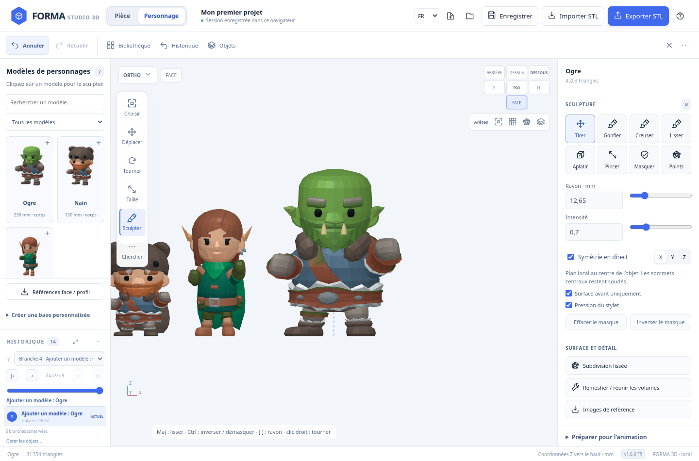

# FORMA 3D

### Local 3D modeling and STL editing — right in your browser

**HTML5 / CSS3 / JavaScript · Native WebGL · 100% Local & Self-Contained**

[](LICENSE)
[]()
[]()
[]()


---

FORMA 3D is a lightweight, self-contained 3D mesh editor for designing parts from geometric primitives and modifying imported STL files directly inside your web browser. Resize objects with intuitive on-canvas handles, combine solids, subtract hole volumes, extrude planar faces, sculpt details, and export clean STL files ready for your 3D slicer.

> **No account required · No cloud processing · No CDN assets · Zero runtime dependencies (no npm).**

---

## 📂 Repository Contents

This repository is designed to be minimal, ultra-portable, and instantly usable without any build toolchain:

| File | Description |
| :--- | :--- |
| **[`FORMA3D.html`](FORMA3D.html)** | **Complete standalone French/English application** with a live FR/EN selector (all HTML, CSS, JavaScript, WebGL renderer, CSG engines, embedded WebAssembly, and demo part in one file). |
| **[`FORMA3D_EN_Preview.png`](FORMA3D_EN_Preview.png)** | High-resolution user interface screenshot and preview image. |
| **[`LICENSE`](LICENSE)** | MIT Open Source License (Nicolas Hanteville & contributors). |
| **[`README.md`](README.md)** | User guide and comprehensive project documentation. |
| **`src/tools-*.js`, `src/auto-fillet.js`, `src/tools-locales.json`, `src/tools.css`** | Shared sources for the new patterns and inspection tools, embedded into the bilingual standalone application. Needed only for development. |
| **`scripts/embed-tools.py`** | Rebuilds the embedded tools and bundled local geometry runtime. |
| **`vendor/manifold-3d/`** | Pinned Manifold 3.5.4 JavaScript/WebAssembly and Apache-2.0 license, embedded for local rounding of complex parts. No runtime download. |
| **`tests/test_tools.py`, `tests/test_i18n.py`** | Browser, geometry and live FR/EN regression checks, including offline use. |
| **`src/i18n.js`, `src/i18n-ui.js`, `src/app-locales.json`** | Language selection, persistent interface translations and live editor updates. Embedded by `scripts/embed-tools.py`; no runtime imports. |

---

## 🚀 Quick Start

### 1. Direct Launch (Easiest)
Simply double-click on **`FORMA3D.html`** to open it in any modern desktop browser (Google Chrome, Mozilla Firefox, Microsoft Edge, Safari, Brave, etc.) with hardware acceleration/WebGL enabled.

Use the **FR / EN selector** in the header to change language instantly. The browser language determines the initial selection; your choice is remembered locally when storage is available. Direct links can override it with `?lang=fr` or `?lang=en`. Switching keeps the scene, current selection, undo/redo branches and session clipboard without reloading or creating a history entry. Existing `.forma3d` projects and `.forma3dlib` libraries remain compatible; your own object and project names are preserved.

Because it is a single self-contained HTML file, you can keep it on a USB flash drive or offline drive and use it anywhere without an Internet connection.

### 2. Optional Local Web Server
Some strict corporate environments or browser privacy policies restrict Web Workers or IndexedDB storage on direct `file://` URLs. If needed, you can serve the directory using any lightweight static web server:

With **Python 3**:
```bash
python3 -m http.server 8080
```
Then navigate to: [http://127.0.0.1:8080/FORMA3D.html](http://127.0.0.1:8080/FORMA3D.html)

With **Node.js**:
```bash
npx serve .
```

*Note: All computation, CSG operations, and rendering take place locally inside your browser client. The server only delivers static files over loopback.*

---

## ✨ Features

| Area | Features & Included Tools |
| :--- | :--- |
| **Shape library** | 26 built-in shape tools, including primitives, polyhedra, text, springs, screws and threaded-hole cutters; personal reusable shape libraries. |
| **Faithful previews** | Shape thumbnails dynamically rendered from exact primitive geometries with visible openings and proportions. |
| **Direct manipulation** | Move (`G`), rotate (`R`), resize handles (`S`), clickable on-canvas dimensions, grid snapping, automatic edge/center alignment with purple guides, and proportional scaling. |
| **Patterns** | Linear, rectangular grid and circular patterns; custom center/axis, full turns or partial arcs, optional copy rotation. Copies retain materials, parameters and source shapes. |
| **2D sketches** | Draw in Top, Front and Right views; right-click to add anchors or insert them on existing lines and curves, including closed outlines. Right-drag pans the view; additions support undo/redo. |
| **CSG Solid operations** | Union, subtraction, intersection, and automatic Solid / Hole roles. Retain hidden source objects if desired. |
| **Mesh editing** | Positive/negative planar face extrusion (`E`), plane slicing (`Cut`), connected component separation, automatic outer-edge rounding with one radius (whole part or one side), manual single-edge fillets (`O`), and subdivision. |
| **Sculpting** | Inflate, deflate, smooth, and flatten brushes (`B`) with configurable radius and pressure. |
| **Inspection & Analysis** | Two-point caliper measurement (`M`), wireframe mode, X-ray transparency, smooth shading, mesh diagnostics, and interactive section inspection along X/Y/Z with colored section surfaces. |
| **Physical properties** | Per-object materials and density, full-solid theoretical mass, transformed surface area and volume, and density-weighted center of gravity. |
| **STL Import & Export** | Binary and ASCII STL support, multi-file drag-and-drop, unit conversion (mm, cm, m, inches), and optional separation into independent parts during import. |
| **Project management** | Native editable `.forma3d` format, branching undo/redo history, retained source shapes and materials, automatic IndexedDB session backup, and high-resolution PNG snapshots. |

---

## 💡 Common Workflows

### Character Studio / Atelier personnage · v1.6



Use **Part / Character** (**Pièce / Personnage**) in the header to switch workspaces. The character workspace replaces mechanical settings with contextual sculpting controls. The vertical toolbar provides selection (`V`), move (`G`), rotate (`R`), resize (`S`) and sculpt (`B`). Library and history can be collapsed independently; Space opens searchable commands. All features run locally in the bilingual standalone HTML file.

**Pour commencer en français :** ouvrez `FORMA3D.html`, choisissez **Personnage**, puis cliquez sur un modèle dans **Modèles de personnages**. Sept figurines complètes sont incluses : **Chevalier**, **Mage**, **Rogue**, **Gobelin**, **Ogre**, **Nain** et **Elfe**. Elles ont un visage, une tenue et des couleurs. Le filtre **Monstres** regroupe le gobelin et l’ogre ; **Nains et elfes** regroupe les deux peuples fantastiques. L’ajout se fait en un clic ; un nouveau personnage est placé à côté des objets existants. La recherche et les filtres permettent de retrouver un modèle. Les bases Tête / Buste / Corps restent accessibles sous **Créer une base personnalisée**.

The **Knight, Mage and Rogue** are original artist-made assets by **Kay Lousberg / KayKit**, from the [official Adventurers Character Pack](https://github.com/KayKit-Game-Assets/KayKit-Character-Pack-Adventures-1.0), revision `672074b73ba276876a19e8816ecdc5241817ab47`, under **CC0 1.0**. Full source GLBs, the creator's licence and SHA-256 provenance are retained in `assets/characters/kaykit/`; the licence is also embedded in the standalone application. Their geometry and colour previews are bundled, so inserting them requires no network access.

The **Goblin, Ogre, Dwarf and Elf** are **FORMA adaptations of the complete KayKit meshes**, not additional original characters from the pack. They are baked from the Rogue (goblin/elf) and Barbarian (ogre/dwarf), with edited proportions and palettes, pointed ears, fangs/tusks where applicable, and retained clothing. The original [KayKit source and CC0 licence](https://github.com/KayKit-Game-Assets/KayKit-Character-Pack-Adventures-1.0) also document their base assets. The exact source hashes, recipe hash and resulting mesh hashes are recorded in [`assets/characters/kaykit/adaptations.json`](assets/characters/kaykit/adaptations.json); the reproducible recipe is [`scripts/prepare-character-models.py`](scripts/prepare-character-models.py). The previous Barbarian and Hooded Rogue identifiers remain readable in existing projects, but are no longer shown in the seven-figurine catalogue.

The native editor uses an editable mesh baked from the artist's unarmed idle pose. Original gradient-atlas colours are sampled into vertex colours, retained by sculpting, masks, transforms, subdivision, copying, project files, autosave and GLB export. The source GLBs retain the original rigs and animation clips; inserting a model does not add those clips to the editor. As game assets, the characters have intentional open garment surfaces and overlapping parts: an STL export alone does not make them watertight printable solids.

| Tool | Behaviour |
| :--- | :--- |
| Sculpt brushes | Grab, inflate, carve, smooth, flatten, pinch and paint mask. Direct buttons, radius/strength controls and a cursor projected onto the surface. |
| Live symmetry | Reflects brush influence around the chosen **local** X/Y/Z plane through the object's original centre for each stroke. It does not first turn an asymmetric source into a symmetric object. Existing welded centre vertices stay on the plane. Vertex editing mirrors matched vertex pairs. |
| Mask | Protects vertices from sculpting. `Ctrl` / `Cmd` erases while using the mask brush. Clear and invert are undoable. Masked areas are blue-grey in the character workspace. |
| Gestures | Hold `Shift` for temporary smoothing, `Ctrl` / `Cmd` to invert other brushes, `[` / `]` or `Shift` + wheel to change radius. Right drag orbits; middle drag / Alt drag pans. Pen pressure controls brush strength when enabled. Returning to sculpt keeps the current brush. |
| Smooth subdivision | A real Loop subdivision moves vertices to round the silhouette, unlike the existing triangle-only subdivision. Input limit: 28,000 triangles. It can shrink volumes. A hidden original is retained. |
| Volume remeshing | Reconstructs and joins selected closed volumes on a 32/48/64/96-cell grid along the longest axis. A hidden original is retained. Small details, narrow gaps and thin walls can disappear. Output is triangles, not automatic anatomical quad topology. |
| References | Load front/right PNG, JPEG or WebP images, adjust scene height, offsets and opacity. Images appear behind models in matching orthographic views and are embedded in native projects. They are excluded from STL and GLB exports. Images are resized to at most 1,600 pixels on their longest side. |
| Vertex / face tools | In Points, select two neighbouring vertices to split an edge, or switch to Faces and click / Shift-click triangles to extrude a selection. These operations do not detect all self-intersections. |
| Manual retopology | Under Prepare for animation, start a new surface over the selected source. Four clicks create a quad; nearby existing vertices snap together. Quads are stored in the project and triangulated for display/export. Build patches in consistent winding order. This is manual patch construction, not automatic anatomical retopology; unfinished surfaces are open. |
| UVs | Cylindrical, spherical or planar projections with a wire layout preview. The selected projection is stored and included in GLB. Limbs can overlap in UV space; there is no anatomical unwrap or texture painting. |
| Skeleton / pose | Creates an adjustable 17-joint humanoid skeleton. Edit local rest positions and rotations, preview without changing the source, keep the skeleton for GLB, or bake a pose into the mesh. Automatic weights use proximity to bones; fingers and difficult deformations need additional rigging work. Baking removes the skeleton. No animation timeline or clips are generated. |
| Wall thickness | Samples about 1,200 inward normal rays on a closed mesh and reports the sampled minimum and values below a chosen threshold. Sampling cannot certify the absence of thinner regions between rays. Existing cut, separation, diagnostics and STL tools remain available. |
| GLB export | Exports selected unlocked visible solids with colours, normals, projected UVs and real skin joints/weights when a skeleton is present. Coordinates are converted from mm/Z-up to metres/Y-up. It does not export reference images, masks or animation clips. |

Sculpting, topology tools and remeshing accept up to **120,000 source triangles**. Remeshing also caps the extracted surface at 120,000 triangles; lower the resolution when this budget is exceeded. Mesh operations reset masks and skeletons on the newly created result where vertex correspondence changes. Sculpt strokes, masks, native project files, autosave and branching undo/redo retain their data. Native JSON files quantize mask strength to 8 bits; autosave retains Float32 values. Existing projects without character data remain readable.

For brush interaction, a reusable vertex spatial index limits neighbourhood searches; a refittable triangle BVH accelerates picking. Sculpt strokes update affected normals and GPU buffer ranges rather than rebuilding all rendering buffers. These are implementation improvements, not a guaranteed frame rate on every device. Source meshes and previous history states are not modified in place.

Character sources are maintained in `src/character-core.js`, `src/character-models.js`, `src/character-ui.js`, `src/character-worker.js` and `src/character.css`. `scripts/embed-tools.py` embeds them in the bilingual application and the isolated geometry worker. No additional runtime library or service is introduced. To rebuild the artist models from the bundled GLBs, use `python3 scripts/prepare-character-models.py` (development only: NumPy/Pillow), then `node scripts/build-character-previews.cjs`, then `python3 scripts/embed-tools.py`. `node scripts/build-character-previews.cjs --check` checks preview freshness.

### 1. Create and resize a part
1. Click any shape from the left library panel to add it to the scene.
2. Select the shape. Dimensioning handles appear automatically in **Move (`G`)** and **Resize (`S`)** modes.
   - **X, Y, Z face handles**: stretch or shrink along that axis while keeping the opposite side fixed.
   - **Bottom corner handles**: adjust width and depth simultaneously.
   - Hold **`Shift`** (or toggle *Proportions*) to scale all three dimensions uniformly.
   - Hold **`Alt`** (or toggle *From center*) to resize symmetrically around the center.
   - **Click any numerical dimension** in the 3D viewport to type an exact measurement in millimeters (`Enter` to apply, `Esc` to cancel).

### 2. Subtract a hole from a solid
1. Add or import your solid base part.
2. Add a cutting shape (e.g., a cylinder) and position it overlapping the part.
3. In the right-hand Inspector, switch its role from **Solid** to **Hole**.
4. Select both the solid part and the hole using **`Shift` + click**.
5. Choose **Operations → Merge / apply holes**.
6. The operation merges any solids and subtracts the hole volumes cleanly without adding unwanted geometry.

With **Align** enabled at the bottom of the viewport, dragging snaps the selection’s outer edges and center to other visible objects. Locked objects can serve as references. Purple guides show the active alignments. Multi-object selections keep their relative spacing, and axis handles keep their movement constraint. Hold **Shift during the drag** to suspend object alignment; grid snapping remains independently controlled by **Snap** and its step.

### 3. Modify an existing STL file
1. Click **Import STL**, select your file, and confirm its coordinate units (the editor operates internally in millimeters).
2. Leave **Separate disconnected elements into independent parts** checked to get one editable object per disconnected component. Relative placement is preserved; centering moves all imported parts together. Uncheck it to keep one object per file. For an existing mesh, select it and click **Separate into parts** in Properties or Operations (**Séparer en pièces** in French). Each part keeps its appearance, material and dimensions; undo restores the complete mesh. The Operations option to keep hidden source copies also applies to separation.
3. Click a part in the scene or object list to select it alone, then move, resize, delete or export it independently. A connected shape needs **Cut → Create two separate parts** to divide it along a plane. Disconnected component separation does not recover an STL's original CAD construction history; it supports up to 200 components per mesh within the 300-object scene limit and 180 MiB geometry budget.
4. Use **Resize** to adjust dimensions, **Cut** to slice the mesh along a plane, **Face** to extrude planar surfaces, or **Sculpt** for localized surface shaping. Click **Export STL** when ready; **Visible selection** exports just the selected part (choose Binary format for faster slicing and smaller file size).

### Automatic rounding of outer edges
1. Select one visible, unlocked solid and click **Automatic rounding** in Properties, or open **Round edges (`O`)**. Choose **All outer edges**, **One side only**, or **One chosen edge**. French labels: **Arrondi automatique**, **Toutes les arêtes extérieures**, **Un seul côté**, **Une arête choisie**.
2. Set **Edge orientation** to **All orientations**, **Vertical edges only** or **Horizontal edges only** (**Orientation des arêtes** in French). This filter combines with the whole-part or one-side selection. Directions follow the local Z axis of the object, including its rotation; camera orbit has no effect. Oblique edges are retained only with All orientations.
3. Set the **radius in millimeters**. For complex parts, **Adapt the radius to thin areas** is on by default: the entered value is the maximum, and each narrow area receives a smaller radius where needed. The preview reports the actual radius range and adapted edge count. Turn it off to require the exact requested radius on every edge. With one side selected, choose Top, Bottom, Left, Right, Front or Back; directions follow the object's local axes and rotation. The selected straight edges are highlighted, and the preview updates automatically. A shared radius range reserves clearance for neighboring bands.
4. Compare with the original, then **Apply**. Preview geometry stays out of projects, autosave and STL exports until applied. Cancel or Escape discards the preview; one undo restores the entire applied operation. Other objects, materials and colors are preserved.
5. Convex parts are clipped from their original edges together; fully selected three-face corners also receive spherical patches. Parts with openings, non-convex outlines and attached walls use bounded local cutters with the embedded Manifold kernel. Endpoint planes are independent of the old isolated-edge solver, so reentrant endpoint junctions no longer block the entire operation. A Float32 round-trip validates closure and orientation before preview; component count and genus checks protect connected walls and through-openings. Detection works on primitives and imported STL geometry, up to 120,000 source triangles and 120 selected straight edges. Curved rims, inward corners and unsuitable meshes are not supported; no partial result is applied on failure. The manual single-edge mode remains available.

### 4. Create a circular pattern or a grid
1. Select the visible, unlocked objects to repeat and open **Pattern** in Properties, or **More tools → Patterns**.
2. Choose **Linear**, **Rectangular grid** or **Circular**. Counts include the original selection. Grid spacing separates selection occurrences in world coordinates.
3. For circular patterns, choose the world axis and the point it passes through. A full turn distributes copies without repeating the first position; a partial arc includes both endpoints. Turn off **Rotate copies** to preserve each object's orientation.
4. Create the copies. The complete pattern is one undo step, with a maximum of 300 scene objects and the existing geometry memory budget.

### 5. Inspect the interior and measure mass
1. Open **Section inspection** in Properties or More tools. Move the plane with the slider or enter a coordinate, select X/Y/Z, and optionally reverse the retained side. Orange surfaces show the section; existing cavities are preserved where capping succeeds.
2. Rotate, pan and zoom to inspect. Collapse the controls with **−** to free the view on small screens. Close with **×** or **Esc**. Editing also closes inspection. Project saves and STL exports always use the complete original geometry. Section settings are temporary and do not add history states.
3. Select solids, assign **Material & density**, then open **Mass & center of gravity**. Density is in g/cm³; presets are indicative and editable. Assignments survive project saves, history navigation, copying and library storage. A merge inherits material only when all solid inputs have the same assignment.
4. Reported mass assumes fully dense solids and does not estimate infill, supports or slicer settings. Separate objects are summed, so overlaps count twice and Hole objects are ignored. Merge and apply holes first to measure the finished part. Open, invalid or inverted meshes do not receive a mass result; every measured solid needs a material for a combined mass and center of gravity.

---

## ⌨️ Navigation & Keyboard Shortcuts

| Action | Mouse / Keyboard Input |
| :--- | :--- |
| **Select object** | Left click |
| **Add / remove from selection** | `Shift` + click |
| **Box selection** | `Shift` + drag background |
| **Camera orbit** | Right-drag or drag background |
| **Camera pan** | Middle-drag or `Alt` + drag |
| **Zoom** | Mouse wheel / pinch gesture |
| **Move / Rotate / Resize** | `G` / `R` / `S` |
| **Face / Sculpt / Measure** | `E` / `B` / `M` |
| **Frame selection in view** | `F` |
| **Undo / Redo** | `Ctrl + Z` / `Ctrl + Shift + Z` (or `Ctrl + Y`) |
| **Save / Open project** | `Ctrl + S` / `Ctrl + O` |
| **Copy / Cut / Paste objects** | `Ctrl + C` / `Ctrl + X` / `Ctrl + V` (or `Cmd` on macOS) |
| **Paste at copied coordinates** | `Ctrl + Shift + V` |
| **Duplicate object** | `Ctrl + D` |
| **Select all** | `Ctrl + A` |
| **Delete object** | `Delete` or `Backspace` |
| **Step move along grid** | Arrow keys (X/Y) · `Shift + ↑ / ↓` (Z) |
| **Finish a numeric edit and return to the viewport** | `Enter` |
| **Temporarily suspend automatic object alignment** | Hold `Shift` during the drag |
| **Cancel current tool/gesture** | `Esc` |

---

## ⚙️ Technical Limits & Specifications

FORMA 3D is a lightweight polyhedral mesh editor tailored for rapid 3D printing preparation and quick modifications. It is not an exact mechanical CAD B-rep kernel with parametric feature history (such as SolidWorks or FreeCAD).

- **Boolean complexity**: 80,000 combined triangles per operand pair.
- **STL file input**: up to 100 MB per file.
- **Geometry budget**: up to 1,200,000 triangles per object.
- **Batch import**: up to 20 STL files per import.
- **Project capacity**: up to 300 scene objects.
- **Rolling history**: keeps the 1,000 most recent states across branches, within 256 MiB of unique mesh arrays. New edits automatically replace the oldest states. Large meshes may shorten the retained window. Undo reaches only retained states; branches with expired parents start at their earliest retained state. The current viewed state is preserved when opening older projects.
- **Direct dimensions range**: 0.01 mm to 100,000 mm.

## Development checks

Character Studio checks: run `node tests/test_character_core.cjs` for geometry, remeshing, BVH, topology, UV, skeleton and binary GLB checks, and `python3 tests/test_character.py` for creation, brushes, mask/history persistence, references, UV/rig/pose dialogs, manual retopology, worker operations and desktop/tablet/mobile layouts in both languages.

Finished model checks: `node tests/test_character_models.cjs` validates all seven meshes, colour arrays, transforms, GLB colour attributes, source hashes and previews. `python3 tests/test_character_models.py` checks one-click insertion, search/filter/empty states, sculpture and undo, colour persistence through native files/autosave/clipboard, coloured GLB export, the original wire/grid rendering paths, narrow layouts and blocked external requests in both languages.

The single `FORMA3D.html` file contains both languages and works on its own. To update the shared tools or language controls, edit their sources in `src/`, then run:

```bash
python3 scripts/embed-tools.py
python3 scripts/embed-tools.py --check
```

Run `python3 tests/test_tools.py` for syntax checks, analytic geometry checks, and browser workflows in both languages. Run `python3 tests/test_stl_parts.py` for STL component separation, import options and units, independent editing and export, source retention, undo/redo, capacity limits and narrow-screen checks in the bilingual application. Run `python3 tests/test_auto_fillet.py` for analytic radius and volume checks, six-side isolation, vertical/horizontal filtering, rotated/scaled objects, imported STL, preview/apply/cancel, undo/redo, manual-edge compatibility, export and narrow-screen controls. Run `node tests/test_auto_fillet_complex.cjs` for the actual bundled worker initialization, automatic rounding around openings and attached walls, local radius adaptation, exact-radius refusal, retained openings and connectivity, one-side operations and binary STL round-trips. Set `FORMA_TEST_PROJECT` to a local `.forma3d` path to include that project in the read-only geometry regression; no personal fixture is stored in the repository. Run `python3 tests/test_sketch_points.py` for right-click sketch drawing, insertion, curve preservation, pan and undo/redo checks. Run `python3 tests/test_alignment.py` for edge/center alignment, zoom tolerance, multi-object dragging, rotated/scaled references, movement planes and axes, temporary bypass, grid interaction, undo/redo and narrow-screen layout in the bilingual application. Run `python3 tests/test_history.py` to verify rolling replacement after 1,000 states, old project migration, complete file and autosave restoration, retained branches, undo/redo, and memory budget handling. Run `python3 tests/test_keyboard.py` for keyboard focus, numeric entry, text and object clipboard, cut/undo and pointer movement checks in the bilingual application, using the same HTML file directly and through a local web server. Run `python3 tests/test_i18n.py` for live FR/EN switching, unchanged project/branches/clipboard, worker language, parameter labels, persisted preferences, blocked storage and standalone offline use. Development checks require Node.js, Python Playwright and Chrome/Chromium; the application has no such runtime dependencies. Set `FORMA_CHROME` if the browser executable is not on the default path.

---

## 📄 License & Attribution

Distributed under the **MIT License**. See [LICENSE](LICENSE) for details.

- **Author**: Nicolas Hanteville and FORMA 3D contributors.
- **Local rounding kernel**: [Manifold 3.5.4](https://github.com/elalish/manifold), bundled under Apache-2.0 (see `vendor/manifold-3d/LICENSE` and the embedded license). No server processing or external asset requests.
- **CSG Engine**: The BSP solid boolean implementation adapts portions of **csg.js by Evan Wallace** (Copyright © 2011, MIT License).
